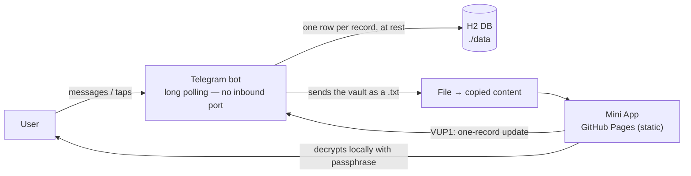

# Botwheel Vault

A server-less credentials manager for Telegram. Two parts:

- **Mini App** — the UI (static, GitHub Pages). All cryptography runs in the browser.
- **Telegram bot** — long polling only; stores each user's encrypted records and hands the whole vault back over chat.

No backend, no database server — and the bot never sees your passphrase.



**What you can do:** search and view records; create, update and delete records. Open the Mini App with the bot's keyboard button below the message field — it is the only launch that can push a change back to the bot automatically (and even that falls back to a copied `VUP1:` payload). Each change only carries the one record that changed, so it always fits in a single message.

**Encryption is client-side:** every record is encrypted whole (`r1.…`, Argon2id-derived key) and the vault is a container of those opaque records (`VLT3:`); the server adds an at-rest layer (`SRV1.`) on top of everything it stores.

---

## Deployment

Two parts, deployed separately.

### Prerequisites
- Bot token from **@BotFather**.
- Repo hosted on GitHub; Docker + Compose on the server.

### 1. Mini App (GitHub Pages)
1. Push `public/` to `main` → `.github/workflows/deploy-pages.yml` publishes it.
2. Repo **Settings → Pages → Source: GitHub Actions** (once).
3. Note the URL (`https://<user>.github.io/<repo>/`) — needed as `MINIAPP_URL`.

### 2. Bot (Docker)
Create `.env` next to `docker-compose.yml`:
```
TELEGRAM_BOT_TOKEN=123456:AA...your-token...
```
Run:
```
docker compose up -d
```

**Config** (env vars; `bot.properties` is only for local runs):

| Var | Needed | Meaning |
|---|---|---|
| `TELEGRAM_BOT_TOKEN` | ✅ | BotFather token |
| `MINIAPP_URL` | ✅ | Your Pages URL (else buttons point nowhere) |
| `TELEGRAM_DB_PATH` | – | H2 DB path (default `botwheel-db`; Docker `/data/botwheel`) |
| `TELEGRAM_DB_KEY_FILE` | – | At-rest key file (default `/data/botwheel.key`; `off` disables) |
| `TELEGRAM_ALLOWED_USER_IDS` | – | Comma/space list; empty = everyone |
| `TELEGRAM_SEED_FILE` | – | Optional vault container seeded (split into rows) on first `/start` |

**Ports:** none — long polling makes outbound calls only; do not publish a port.

**Volume:** `./data:/data` — holds the DB (`botwheel-db.mv.db`) **and** the at-rest key. Back them up together.

### 3. Keys

| Key | Owner | How to get it | Used for |
|---|---|---|---|
| **Passphrase** | user | Chosen in the Mini App (no generation) | Argon2id → AES key; opens the vault + record passwords. Never leaves the device. |
| **At-rest key** | server | Auto-created on first run, **or** `openssl rand -base64 32` → `TELEGRAM_DB_KEY` | Wraps every stored header/ciphertext in the DB (`SRV1.…`). |

- **Back up the at-rest key** — losing it makes every stored record unreadable.
- For real key/DB separation, keep `TELEGRAM_DB_KEY_FILE` off the `./data` volume.
- The bot token is a credential, not a crypto key.

### 4. Smoke test
1. Import your records once: `script\import-csv.cmd <csv> vault.txt` writes the container, then point `TELEGRAM_SEED_FILE` at it. Message the bot `/start` → an **Open Vault** keyboard button appears below the message field; tap **Refresh database** to receive the vault as a **`.txt` file** — open it and copy its whole content.
2. Open the Mini App **from the keyboard button** → enter the passphrase, paste the file content → records appear.
3. Add, edit or delete a record → the Mini App sends just that change to the bot automatically.
4. Tap **Refresh database** again → the updated vault comes back as a file.
